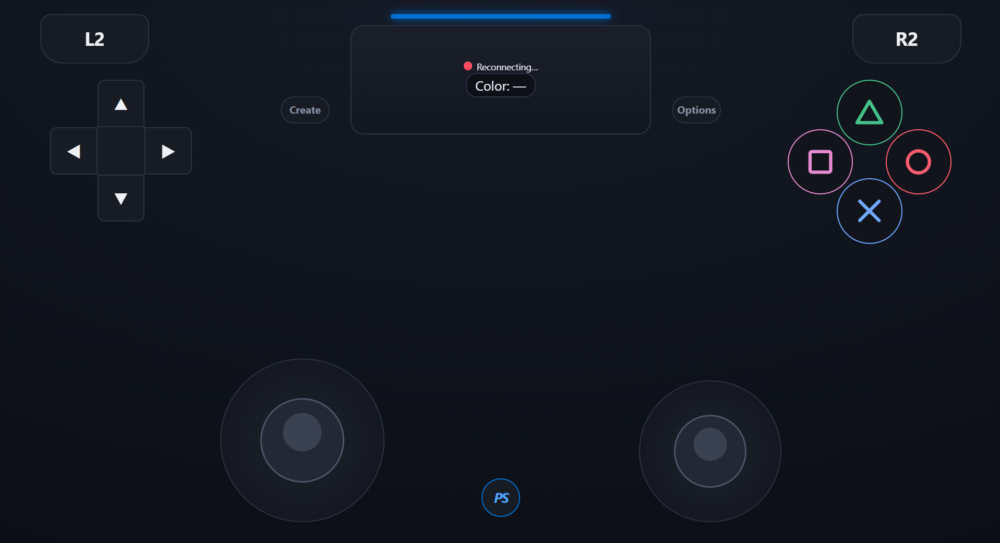

# Robochamp beginner's robot repo
## Summary
This repository contains the code for a beginner's robot designed for the Robochamp competition. The robot is built using basic components and is programmed to perform simple movement and obstacle avoidance tasks.

## Run instructions
1.- Clone the repository to your local machine:
```sh
git clone https://github.com/TEC-Andres/robochamp-beginners-challenge
```

2.- Navigate to the project directory:
```sh
cd robochamp-beginners-challenge
```

3.- Run from platformIO the following command
```sh
pio run -e carController -t upload 
```

4.- On a phone or computer, connect to Robochamp-`<ID>` and open `http://192.168.4.1/`

In the end, something like this should appear in browser with the legend `Connected` and a green dot on the left of it. 

<div style="text-align: center;">
    
</div>